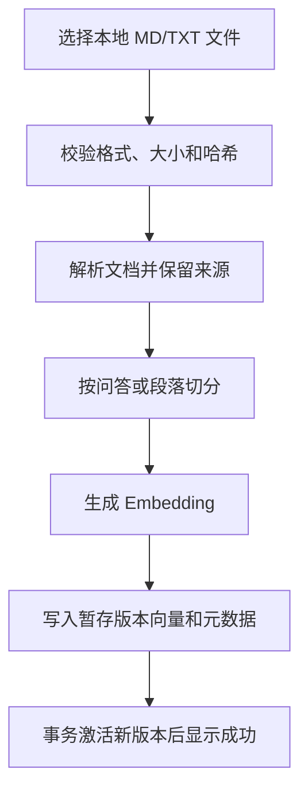
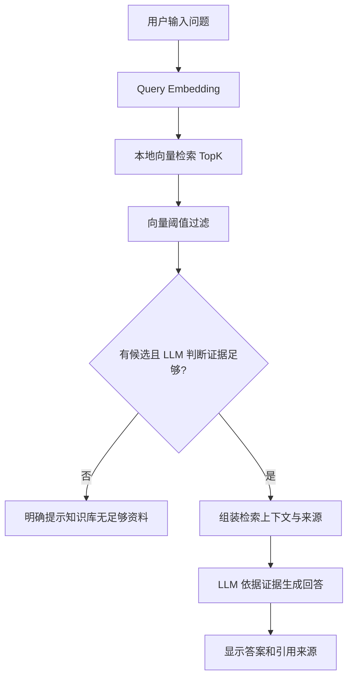

# Agent 面经知识库 RAG — MVP 产品需求文档（PRD）

| 项目 | 内容 |
| --- | --- |
| 版本 | V1.2 MVP |
| 状态 | 开发需求基线 |
| 产品名称 | Agent 面经知识库 RAG |
| 目标用户 | 准备 Agent 开发工程师面试的个人用户 |
| 部署形态 | 本地运行、单用户 |
| 数据范围 | 仅使用用户导入的本地面经知识库 |

## 1. 项目背景与目标

Agent 面试题分散在本地 Markdown、TXT、PDF、DOCX 等资料中，手动查找耗时，且相似问题常采用不同表述。MVP 通过 RAG 将这些资料建立为可检索的本地知识库，允许用户以自然语言查询常见问题及参考答案。

**核心目标：** 用户输入一个 Agent 技术话题或具体面试问题，系统从**本地已导入知识库**召回相关内容，输出面试题、参考答案及可追溯的文件来源。

**核心约束：** 不联网检索、不抓取外部面经、不使用模型自身知识编造知识库里没有的题目或答案。Embedding 在本地运行，LLM 使用远程 DeepSeek Flash API，仅处理用户问题与召回证据，不构成外部知识来源。MVP 要求本地数据源，不要求完全离线推理；生成答案需要网络连接，不调用联网搜索或抓取工具。

## 2. MVP 范围

### 2.1 必须实现（P0）

1. **本地文档导入**：支持从本机选取并上传 Markdown、TXT 文件；PDF、DOCX 作为可选扩展，不作为 MVP 验收阻塞项。
2. **知识库构建**：提取文本，按面试题/答案优先切分；不能识别问答结构时按标题与文本段落切分，保存来源位置。
3. **索引构建与更新**：对文本块生成 Embedding 并存储向量；上传同一文件时基于文件哈希避免重复入库。
4. **语义检索**：输入自然语言问题，在本地向量索引中检索 TopK 相关片段。
5. **RAG 问答**：仅基于召回的证据生成答案；返回相关面试问题、参考答案、来源信息。
6. **无结果处理**：检索无足够相关证据时明确回复“本地知识库暂无相关内容”，不编造。
7. **简单页面**：文件导入、入库状态、问题输入框、答案与来源展示。
8. **诊断与模型调用记录**：记录请求 ID、检索片段 ID、阶段耗时和错误；在本地数据库保存用户提问、实际模型请求、原始响应及校验后回答，支持按请求 ID 排查。

### 2.2 本期不做

- 外部互联网搜索、爬虫、在线面经同步。
- 多用户账户、权限控制、团队协作。
- 模拟面试、语音面试、简历匹配、错题本。
- 复杂 Agent 工作流、多 Agent 编排和长期记忆。
- 公司面经真实频次榜单；若无可靠来源统计，不显示“高频”事实性排名。
- 自动生成不存在于知识库的标准答案。
- 完整后台审核系统、定时数据采集与知识图谱。

## 3. 典型用户场景

### 场景 A：按技术主题查面试题

用户输入：`LangGraph 常见面试问题有哪些？列出 5 道并给出答案。`

预期：从已导入知识库检索 LangGraph 相关问题，去除本次结果的重复题目，最多返回 5 道，每道包含问题、答案及文件出处。若只检索到 3 道，返回 3 道并说明数量不足；禁止补造 2 道。

### 场景 B：查具体问题

用户输入：`MCP 与 Tool Calling 有什么区别？`

预期：召回本地相关片段，基于其内容组织回答，并标注引用文件。若资料仅提到了 MCP、无法支撑对比结论，明确说明资料不足。

### 场景 C：无命中

用户输入：`知识库没有收录的某个 Agent 框架原理是什么？`

预期：提示本地知识库暂无足够相关资料，不使用模型参数知识直接补答案。

## 4. 功能需求及验收标准

### FR-01 本地文档管理（P0）

- 支持单文件及多文件选择，MVP 必选格式为 `.md`、`.txt`。
- 单文件大小默认上限 10 MB（可配置）。
- 展示文件名、文件哈希、导入时间、状态（待处理/处理中/成功/失败）及错误信息。
- 单用户知识库按文件名识别同一逻辑文档：仅取上传文件的 basename，按 Unicode NFC 规范化后区分大小写比较，不使用客户端目录路径。
- 相同哈希文件重复上传时提示已存在，并返回已有文档 ID，不重复建立有效索引；同名且内容不同则建立待处理版本。同一文件名已有待处理任务时拒绝再次上传并提示等待或重试。
- 新版本的原文件、文本块和向量全部处理成功后，在数据库事务中切换有效版本；切换前继续检索旧版本，新版本失败则保留旧版本。仅检索有效版本，旧版本不提供历史浏览，切换后清理旧数据。
- 保存上传原文件的本地副本，使用内部 ID 组织存储，避免直接以文件名拼接存储路径。
- 上传完成校验并持久化原文件和任务后，返回文档 ID，后台异步处理。前端每 2 秒轮询状态，到成功或失败后停止；批量上传对每个文件单独返回结果。
- MVP 使用数据库持久化任务状态和单个入库 worker，不引入独立消息队列。服务重启后将遗留 processing 任务标记为 interrupted 失败，pending 任务继续处理；用户可手动重试。重试清理未完成的暂存块及向量，避免重复有效数据。
- 支持删除逻辑文档：使所有版本及任务失效，删除对应文本块、向量和原文件副本；运行中的任务不得重新激活已删除文档。原文件清理失败须记录并可重试，删除后的文档立即不再参与检索。

**验收：** 上传含多个问答段落的 Markdown 后，系统显示成功，且可以查询到对应内容；删除后不再引用该文件。

### FR-02 文本解析与切分（P0）

- 解析 UTF-8 Markdown/TXT，保留文档标题、章节、段落位置。
- 优先依据题号、问号、`Q:`/`A:`、Markdown 标题等识别题目与答案。
- 无稳定问答结构时，退化为按标题/段落的普通 Chunk 切分，默认约 500–800 中文字符、少量重叠，参数可配置。
- 每个 Chunk 必须保存 `document_id`、`chunk_id`、`source_file`、`section`、`content`、`line_start`、`line_end`。MD/TXT 行号从 1 开始，范围含首尾；预处理及重叠切分后仍须映射到原始文件位置。
- 不要求 100% 准确抽题；不确定的片段仅作为证据，不强行构造面试题。

**验收：** 能从规则格式的面经提取问题和答案，并准确回溯到原文件；非规则文档仍可检索文本内容。

### FR-03 向量索引与检索（P0）

- 向量数据库必须使用本机部署的 **PostgreSQL + pgvector**；PostgreSQL 保存文档、文本块及相关元数据，pgvector 保存和检索向量。
- 对每个 Chunk 生成 Embedding，写入 PostgreSQL 的 pgvector 向量列并持久化。
- Embedding 固定采用本地运行的 **`google/embeddinggemma-300m`（EmbeddingGemma 第一代）**，默认输出 **768 维**向量，对应 pgvector 的 `vector(768)`。部署时锁定模型 revision 并记录，不自动切换至其他版本。
- 文档入库和查询必须使用相同的模型 revision、向量维度及配套预处理规则；分别使用模型官方推荐的文档与查询编码方式。
- 单次模型输入不得超过 2,048 tokens（含任务提示等开销）；切分后按模型 tokenizer 校验，超长片段进一步切分，不静默截断。入库采用小批量处理，批大小可配置，以适配本机 Apple M1 / 8GB 内存环境。
- 查询时将 Query 向量化，普通问答默认候选 TopK=8；TopK 合法范围 1–50。列题数量 N 的范围为 1–20；列题时有效候选数为 `min(50, max(top_k, 3*N))`，避免固定 TopK=8 限制返回数量。文本中的 N 与显式 limit 冲突时，以显式 limit 为准；无明确数量时默认最多 5 道。候选数不等于题目数，候选不足时不承诺找全知识库全部题目。
- 使用余弦相似度进行过滤，分数定义为 `1 - cosine_distance`；阈值由固定中文测试样本标定并配置，不将分数解释为正确概率。
- 先进行向量阈值过滤，无候选直接返回 insufficient；有候选时由 LLM 判断证据是否足以支持用户所问内容，再基于充分证据生成答案。LLM 不能引入外部知识作为充分性的依据。
- 候选上下文有 token 预算，优先保留高相关完整片段及来源；记录预算配置。因召回上限或预算未覆盖全部资料时，只报告本次检索找到的数量，不断言整个知识库仅有这些题目。
- MVP 仅实现向量检索；BM25、RRF、Reranker 暂不要求。
- 来源信息随结果一同返回。

**验收：** 使用实际中文面经及改写问题验证召回效果；语义相近但表述不同的问题能够召回相关面经片段；重新启动服务后索引仍可用。Embedding 模型下载完成后，文档和查询向量化可在本机离线完成。

### FR-04 RAG 问答（P0）

- 根据检索证据生成答案，系统提示词应明确：只可使用提供的上下文，不能补充未被证实的事实。
- 查询为“列出 N 道题”时，优先识别知识库中的原始题目，聚合去重，最多返回 N 道，并注明实际返回条数。
- 查询为“解释某道题”时，返回简洁参考答案，并列出支持答案的来源。
- 原文只有题目而没有答案时，可在列题结果中展示原题，答案为空并注明“原文未提供答案”；不得由 LLM 补写。若用户要求解释该题且无其他证据可支撑，则返回 insufficient。
- 题目按去除题号、空白和标点后的规范化文本精确去重；多个来源合并引用。不要求用语义模型合并所有改写题目。
- 回答先做证据充分性判断，再生成结构化结果；后端校验来源 ID 属于当前有效候选，且每条答案存在引用。结构无效或引用越界时返回生成错误，不以未经校验的内容展示。
- 对明显无证据或证据不足的情况返回明确提示，不以流畅生成代替证据。
- 每条引用应关联实际用于生成的有效 Chunk，返回文件名、章节及原文行号范围；不得虚构文件名和章节。页面支持展开原文件文本并高亮对应行。并发删除或替换导致来源失效时，返回可重试的来源变更错误。

**建议输出结构：** 问题、参考答案、来源文件（及章节）、资料不足提示（必要时）。

**验收：** 所有输出中的来源都能打开或定位到原文；删除来源后再次查询不得继续引用。

### FR-05 简单 Web 页面（P0）

页面 A — **知识库**：上传文件、查看处理状态和文件列表、删除文件。

页面 B — **问答**：文本输入、提交查询、加载状态、面试题/答案展示、展开来源片段。

- 初版无需账户登录，默认仅在本机访问（如 `127.0.0.1`）。
- 一次查询一次回答；多轮上下文理解可后续实现。初版采用非流式响应，查询过程中禁止重复提交。
- 知识库页对替换失败显示错误并标明旧版本仍可用，提供重试入口；问答页区分“资料不足”“模型服务不可用”“入库失败”等状态，技术故障不得展示为资料不足。

**验收：** 用户无需命令行即可完成导入、提问、查阅来源的完整流程。

### FR-06 基础运行日志（P0）

- 记录导入处理成功/失败、请求 ID、检索 TopK 结果 ID、阶段耗时、错误类型。
- 普通运行日志仅在本地保存，默认不记录完整面经原文、模型消息或响应；完整业务内容集中保存在 FR-07 规定的本地模型调用记录中，不重复写入 rag.log。

**验收：** 能追踪一次失败查询发生在解析、向量化、检索还是生成环节。

### FR-07 模型调用与单次问答记录（P0，已实现）

- 保存每次问答的用户原始提问及最终业务响应，按 `request_id` 与 `query_logs` 关联。空库、无候选等未调用 LLM 的请求也须保存问答记录，并明确注明未调用模型及原因。
- 每次实际远程调用单独记录，包括自动重试：保存最终发送的完整 `messages`（系统提示词、用户问题、实际提供的检索上下文）、非密钥生成参数、请求模型名、供应商返回模型名、起止时间、耗时、HTTP 状态及可获得的 token usage。
- 保存供应商原始响应体和从中解析的助手消息；JSON 格式错误、引用校验失败时仍保留原始响应，另行保存校验错误，不能只保存最终展示答案。
- 保存服务端校验后的最终回答、题目列表、实际引用及资料不足提示；区分供应商原始输出与最终展示结果。超时、网络中断或进程崩溃时未获得响应须明确标记，不能伪造响应内容。
- 上下文记录保存当次实际送入模型的证据快照（文本、文件名、章节、行号、文档及片段 ID）。只存片段 ID 不足以还原历史；未送入模型的候选不得冒充模型上下文。
- 单次问答与模型尝试状态分开保存：问答包含 running / answered / insufficient / error / interrupted，模型尝试包含 pending / succeeded / error / interrupted；用 attempt_no 识别重试次数。请求发送前先登记尝试，服务重启后把遗留未完成记录标为 interrupted，避免将“无记录”解释为“没有调用”。
- PostgreSQL 使用独立的 `query_records`、`llm_calls` 表，JSON 内容使用 JSONB。`query_logs` 继续承担轻量诊断摘要，不把完整对话混在普通日志文件里；用户可通过 DBeaver 按 request_id 查看。
- 不存储 Authorization、API Key、HF Token、Cookie 或包含凭据的 URL。系统注入的配置秘密必须脱敏；用户问答与证据正文作为业务内容保存，需在 README 中说明本地留存范围。
- 默认保留 30 天，可配置；支持按请求或时间范围通过本地管理命令清理完整问答及调用记录。删除知识文档后，历史证据快照可保留到期以供排查，但不得进入当前检索或重新成为有效来源；彻底清理资料时需同时清理关联快照，文档须说明此边界。
- 本需求用于单轮审计与排障，不自动将历史记录回填给模型，不新增多轮上下文或聊天历史页面。落库故障必须记录 request_id 和失败阶段，不得声称该次调用已完整保存；发送前尝试记录无法持久化时，不发起远程调用并返回明确错误。

**验收：** 给定页面 request_id，可从 DBeaver 还原该次提问、每次重试的实际请求与响应、证据快照和最终展示答案；错误或无模型调用的请求也有可辨认状态。运行日志及调用表均不出现配置密钥；本需求完成前不得将现有 query_logs 视为完整对话保存。

## 5. 核心业务流程

### 5.1 文档入库



### 5.2 检索问答



## 6. 数据模型（最小集合）

### Document

| 字段 | 说明 |
| --- | --- |
| id | 文档版本 ID，上传后返回，用于状态查询与重试 |
| logical_document_id | 同名逻辑文档 ID，用于版本关联及整体删除 |
| normalized_filename | NFC 规范化的 basename |
| is_active | 是否为当前有效版本，与处理状态独立 |
| replaces_document_id | 被替换的版本 ID（可空） |
| storage_path | 原文件副本内部路径，不向前端暴露 |
| attempt_count | 已尝试处理次数 |
| updated_at | 最近状态变更时间 |
| filename | 文件名 |
| sha256 | 文件哈希，去重依据 |
| status | pending / processing / completed / failed |
| created_at | 导入时间 |
| error_message | 失败原因（可空） |

### Chunk

| 字段 | 说明 |
| --- | --- |
| id | 文本块 ID |
| document_id | 关联文档 |
| section | 章节 / 题号 |
| question | 抽取得到的问题（可空） |
| answer | 原文答案（可空） |
| content | 可检索原文 |
| line_start / line_end | 原文件行号范围，含首尾 |
| embedding | 768 维向量，存于 PostgreSQL 的 pgvector `vector(768)` 列 |

### QueryLog

| 字段 | 说明 |
| --- | --- |
| request_id | 请求 ID |
| query_time | 查询时间 |
| retrieved_chunk_ids | 召回块 ID 列表 |
| retrieval_ms | 检索耗时 |
| generation_ms | 生成耗时 |
| result_status | answered / insufficient / error |

### QueryRecord（表 `query_records`，已实现）

| 字段 | 说明 |
| --- | --- |
| request_id | 问答主键，与 query_logs 及模型调用关联；轻量日志写入失败不应使主记录失去身份 |
| user_query | 用户原始提问 |
| request_options | top_k、limit 等查询参数（JSONB） |
| status | running / answered / insufficient / error / interrupted |
| final_response | 校验后的业务响应（JSONB，可空），包含答案、题目及引用 |
| model_called / no_call_reason | 是否调用模型，以及未调用原因（可空） |
| error_stage / error_code / error_message | 失败阶段、错误码和安全错误说明（可空） |
| started_at / finished_at / expires_at | 开始、结束和留存到期时间 |
| current_stage / lease_key | 当前执行阶段和 PostgreSQL 会话锁标识；用于避免把其他进程中的活跃请求误判为中断 |

### LLMCall（表 `llm_calls`，已实现）

| 字段 | 说明 |
| --- | --- |
| id | 单次远程调用 ID |
| request_id | 关联 query_records；一个请求可有多个调用尝试 |
| attempt_no | 重试序号，与 request_id 联合唯一 |
| status | pending / succeeded / error / interrupted |
| request_model / response_model | 请求模型名和供应商返回的模型标识 |
| request_messages | 实际发送的完整 messages（JSONB，配置秘密脱敏） |
| request_parameters | 非密钥生成参数（JSONB），不得保存请求鉴权头 |
| evidence_snapshot | 实际送入模型的证据快照（JSONB），不依赖现存 chunks 外键 |
| document_ids | 历史证据版本 ID 数组，用于删除源文件后仍按版本清理关联问答 |
| raw_response / assistant_message | 原始响应体（文本，可保存非 JSON 内容）与提取的助手消息（可空） |
| http_status / usage | HTTP 状态、token 用量（JSONB，可空） |
| error_stage / error_code / error_message | 网络、响应解析或输出校验等错误；HTTP 成功不等于业务校验成功 |
| started_at / finished_at / duration_ms | 调用时间及耗时 |

## 7. API 草案

| 方法 | 路径 | 作用 |
| --- | --- | --- |
| POST | `/api/documents` | 上传并持久化任务；新任务返回 HTTP 202，含 document_id、logical_document_id、status；重复文件返回 HTTP 200 及已有 ID |
| GET | `/api/documents` | 查询本地文档列表及状态 |
| GET | `/api/documents/{id}` | 查询文档版本及任务状态，供轮询 |
| POST | `/api/documents/{id}/retry` | 重试失败或中断版本；返回 HTTP 202；成功版本或运行中的任务不重复排队 |
| GET | `/api/documents/{id}/source` | 读取有效原文件文本，供按行高亮；不暴露服务器文件路径 |
| DELETE | `/api/documents/{id}` | 由版本 ID 定位并删除整个逻辑文档、所有版本和任务 |
| POST | `/api/query` | 输入问题，输出回答和引用 |
| GET | `/api/health` | 服务健康状态 |

**接口约束：** 查询返回 `answered / insufficient / error` 三种状态。成功与资料不足使用 HTTP 200；参数错误使用 422，同名任务冲突使用 409，文件类型不支持使用 415，超限使用 413。错误返回 `request_id`、`error_code`、可读 message 和 retryable。LLM 超时返回 504；网络故障、限流或服务不可用返回 503；生成结果校验失败返回 502；鉴权或服务配置错误单独标识。不得返回 API Key 或供应商完整原始错误内容。

`POST /api/query` 请求示例：

```json
{"query": "LangGraph 的状态持久化面试题有哪些？", "top_k": 8, "limit": 5}
```

响应示例（字段结构示意，非真实知识库结果）：

```json
{
  "request_id": "req_001",
  "status": "answered",
  "answer": "根据本地资料整理的回答……",
  "questions": [
    {"question": "示例问题", "answer": "示例答案", "source_chunk_ids": ["chunk_001"]}
  ],
  "sources": [
    {"chunk_id": "chunk_001", "document_id": "doc_001", "filename": "agent_notes.md", "section": "LangGraph", "line_start": 10, "line_end": 18, "excerpt": "原文摘录……"}
  ]
}
```

## 8. 非功能要求

- **数据边界**：检索只查询本地已导入文件；不调用联网搜索工具或第三方知识库。
- **隐私**：原文件、向量索引、问答及模型调用记录和日志保存在本机；完整业务内容按 FR-07 留存和清理，鉴权凭据不入库。Embedding 不上传文本。查询及召回片段会发送至远程 DeepSeek 用于证据判断及生成，README 和问答页面须明确告知此数据流；不上传整份原文件。
- **安全**：文件类型/大小校验；文档文本作为不可信数据，不执行文档内指令；默认本地监听。
- **性能目标**：在 1,000 道面试题左右的数据集上，检索 P95 < 1 秒（不含模型网络调用），完整回答 P95 < 15 秒（取决于模型服务），目标而非绝对保证。
- **可恢复性**：服务重启后可直接查询现有索引；入库失败可重新尝试，不产生重复有效记录。

## 9. MVP 验收用例

| 编号 | 用例 | 预期结果 |
| --- | --- | --- |
| TC-01 | 上传包含 10 道题的 MD 文件 | 成功解析、索引并检索对应内容 |
| TC-02 | 上传同一文件两次 | 提示重复，不重复入库 |
| TC-03 | 用另一种问法查询已有问题 | 召回相关片段并引用文件 |
| TC-04 | 查询本地不存在的技术问题 | 明确提示资料不足，不编造 |
| TC-05 | 请求 10 道题但只收录 4 道 | 只返回有依据的题目并告知不足 |
| TC-06 | 删除已导入文档再查询 | 不再引用该文档 |
| TC-07 | 重启后重新发起查询 | 索引可正常使用 |
| TC-08 | 上传不支持的文件格式 | 返回明确错误，不写入索引 |
| TC-09 | 查看一条答案来源 | 能展开原文件并高亮对应行 |
| TC-10 | 同名不同内容文件替换成功/失败 | 成功后仅检索新版；失败后旧版仍可检索 |
| TC-11 | 入库过程中重启后重试 | 中断状态可识别，重试完成且无重复有效块 |
| TC-12 | 查询只有题目无答案的记录 | 可列出原题并标明无答案；解释请求资料不足 |
| TC-13 | DeepSeek 超时、不可用或输出引用无效 | 显示对应可重试错误，不误报资料不足 |
| TC-14 | 入库或查询过程中删除文档 | 任务不得激活已删文档，响应不得引用失效来源 |
| TC-15 | 成功问答后按 request_id 查记录 | 可查看原始问题、实际 messages、模型原始响应、证据快照及最终回答 |
| TC-16 | 模型重试、超时或返回非法 JSON/引用 | 每次尝试独立保存；保留已获得的原始响应并指出具体错误阶段 |
| TC-17 | 空库或过滤后没有候选 | 问答记录注明未调用模型；不伪造 llm_calls 调用 |
| TC-18 | 删除原文后查看历史调用、执行到期清理 | 历史快照仍可解释旧回答但不参与新检索；清理后完整内容删除 |
| TC-19 | 进程中断、记录写入失败及凭据检查 | 中断可识别；发送前落库失败不调用模型；记录中无配置密钥 |

### 9.1 固定验收集与通过标准

- 开发初期准备并冻结一套 UTF-8 中文 MD/TXT 资料：至少 50 道有答案的题目，覆盖 Agent、RAG、MCP 等主题；另含至少 5 道只有题目无答案的记录、重复题目和无规则段落。
- 查询集至少包含 20 条改写问题、10 条资料内完全无答案的问题、5 条证据不完整的问题，以及列题数量不足、同名替换成功/失败、删除、重启与重试场景。
- 每条检索测试记录预期文件名、章节、行号范围及可接受答案要点；无答案样本标明应拒答或仅展示原题。由人工校对预期，不用模型自己的输出作为真值。
- 将查询样本分成阈值标定集与独立验收集，比例约 1:1，保持各类问题都有覆盖；在标定集上确定阈值及切块参数，验收集不参与调参，调整后须记录版本并完整重跑。
- 独立验收集的有答案改写问题，过滤后候选中至少命中一个标注来源的比例须 ≥90%；普通问答按 TopK=8 计算。无答案及证据不足问题必须全部正确提示不足，不得编造。
- 所有实际输出引用必须有效并准确定位；所有有答案结果须由人工逐条核对核心结论有证据支持。无原文答案的题目不得补写，列题不得超出请求数量。
- TC-01 至 TC-19 均须通过；记录模型配置、阈值、样本版本、运行环境和性能结果。远程服务失败时单独记录可用性错误，不计为正确拒答，也不跳过功能验收。

## 10. 技术栈约束与建议

**硬性要求：** 向量存储使用本机部署的 PostgreSQL + pgvector，元数据统一存储于 PostgreSQL；Embedding 使用本地 `google/embeddinggemma-300m`，输出 768 维向量。前端固定使用 React + TypeScript，后端固定使用 FastAPI，LLM 固定使用远程 DeepSeek Flash。解析库等实现细节可在开发时选择。

| 模块 | 选定方案 |
| --- | --- |
| 前端 | **React + TypeScript** |
| API | FastAPI |
| 文本解析 | Python Markdown/TXT 解析库 + 自定义规则 |
| 向量存储 | **PostgreSQL + pgvector（硬性要求）** |
| Embedding | **本地 `google/embeddinggemma-300m`（第一代，768 维，硬性要求）** |
| LLM | **远程 DeepSeek Flash，API 模型标识 `deepseek-flash`**；用于证据充分性判断与有据生成 |
| 元数据存储 | **PostgreSQL（与向量存储共用数据库）** |

**模型配置与索引兼容性：** 记录模型 ID、revision、向量维度及预处理配置。任一配置变更影响向量兼容性时，必须重新生成文档向量并重建索引，禁止混用不同向量空间。EmbeddingGemma 仅用于文本向量化，答案生成仍由单独配置的 LLM 完成；本地 Embedding 不代表生成环节也已离线。

### 10.1 DeepSeek 调用配置

- 使用官方 API：`https://api.deepseek.com`，通过 OpenAI 兼容 Chat Completions 接口调用，模型标识 `deepseek-flash`。模型名可由配置覆盖，默认保持上述选择；运行与验收时记录请求模型名以及响应中可获得的模型标识，不假定服务商别名永远指向同一版本。
- 官方模型标识核对日期：2026-10-23；参考 [DeepSeek 官方 API 文档](https://api-docs.deepseek.com/)。不启用供应商搜索、抓取或其他外部知识工具。
- API Key 仅由 FastAPI 后端从环境变量 `DEEPSEEK_API_KEY` 读取；不得提交到仓库、返回给浏览器或写入日志。
- 单次用户查询的远程调用总超时默认 30 秒，可配置；仅网络临时故障、限流及服务端临时错误允许最多重试 1 次，退避及所有调用共用总时间预算。鉴权、参数和结果结构错误不自动重试。
- 证据判断与答案生成可合并为一次结构化调用，但逻辑上必须先判断再回答；空候选不调用 LLM。初版非流式响应，模型 token 预算、超时和重试参数均通过后端配置。

### 10.2 本地启动与数据目录

- PostgreSQL + pgvector 默认通过 Docker Compose 启动，使用持久化数据卷；FastAPI 与 React 开发服务在宿主机运行。生产静态页面构建及本地访问方法在 README 中明确，服务默认只监听本机。
- README 提供可复现步骤：依赖版本、数据库启动及迁移、首次模型下载与许可/访问要求、后端配置及启动、前端安装及启动、健康检查、停止与重启。模型缓存完成后 Embedding 可离线运行，DeepSeek 调用仍需联网。
- 提供不含密钥的 `.env.example`，列出数据库连接、DeepSeek 配置、模型 revision、阈值、TopK、批大小、上传上限和数据目录。首次初始化使用显式命令完成模型下载及迁移，不在一次查询中隐式下载。
- 应用数据根目录默认 `./data`（相对项目根目录，可配置），内部划分 uploads 与 logs；模型缓存目录单独记录，数据库由 Compose 数据卷保存。运行数据及密钥不进入版本控制，README 说明备份和清理方式。
- 相似度阈值、切块长度、批大小及向量索引优化参数保留可配置性；以固定样本及本机测试结果标定，不将未经测试的参数写成质量保证。

**实现建议：** MVP 不必引入 LangGraph 或复杂 Agent Harness，采用直线式 `导入 → 索引 → 检索 → 生成 → 引用` 流程即可；当后续出现复杂路由、纠错重试或多轮 Agent 行为时，再评估引入编排框架。

## 11. 交付物与完成定义

MVP 交付物：

1. 可本地启动的前后端程序。
2. 本地文件入库与持久化索引。
3. 可使用的问答界面及来源引用。
4. README（安装、配置、启动、模型数据流说明）。
5. 固定中文验收资料、查询集、预期来源及基于 TC-01 至 TC-19 和质量标准的验收报告。
6. 数据库迁移、Docker Compose 数据库启动配置及不含密钥的环境配置示例。
7. 模型调用及问答留存表迁移、按请求排查示例、到期/关联快照清理命令和使用说明。

**完成定义：** 在没有互联网搜索的情况下，用户能够把本地 Agent 面经导入知识库，以自然语言查找问题和参考答案，查看回答对应的原始面经；对不存在的内容，系统明确说明知识库不足。

## 12. 实现与维护文档索引

- [架构设计](architecture.md)：模块职责、数据模型、向量兼容性、事务和任务边界。
- [核心时序图](sequence-diagrams.md)：上传、同名替换、问答、故障、重启重试与并发删除。
- [API 约定](api.md)：上传使用 multipart `files` 字段；结果统一置于 `results`，逐项返回版本 ID 和状态。多文件请求返回 HTTP 207，逐文件判断成功或失败。
- [固定验收流程](acceptance.md)：标定集与独立验收集、功能用例映射及真实模型验收方式。
- [验证记录](verification.md)：记录实际执行结果和外部依赖限制，不将假模型测试视为真实效果验收。

实现发生行为或接口变更时，代码、上述文档、相关时序图及回归测试须同步维护。

## 13. 需求变更记录

| 日期 | 版本 | 变更 |
| --- | --- | --- |
| 2026-10-24 | V1.2 | 新增 FR-07：本地持久化单轮问答与每次模型调用，包含实际输入、原始输出、证据快照及校验结果；补充留存、清理、错误处理与验收用例。 |

**实现状态说明：** V1.2 新增内容当前为待开发需求。现有 query_logs 只保存调用摘要，不保存完整模型对话；本次文档更新不代表数据库表、调用记录或清理命令已经实现。

实现记录（2026-10-24）：FR-07 已通过迁移 `002_query_audit.sql`、审计存储、逐次 DeepSeek 请求记录和本地管理命令落地。详见 README 的“问答记录与排查”和架构、时序图；新增记录不补录上线前的历史问答，不将历史记录自动作为多轮上下文。
