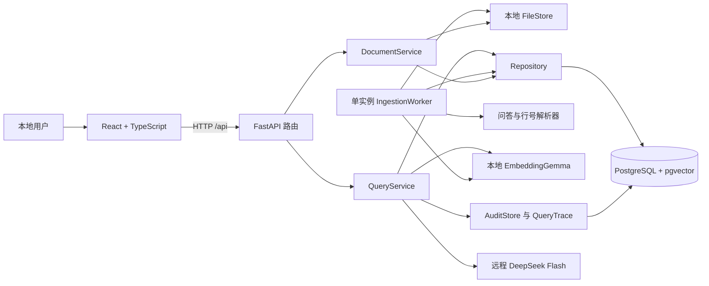
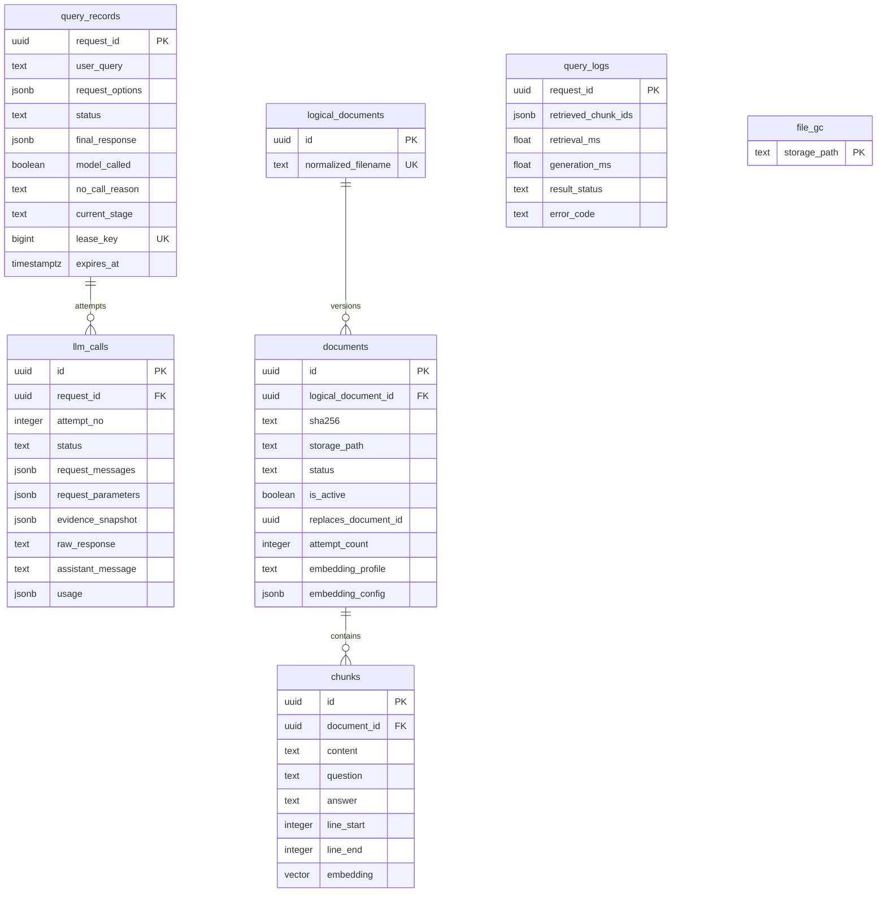
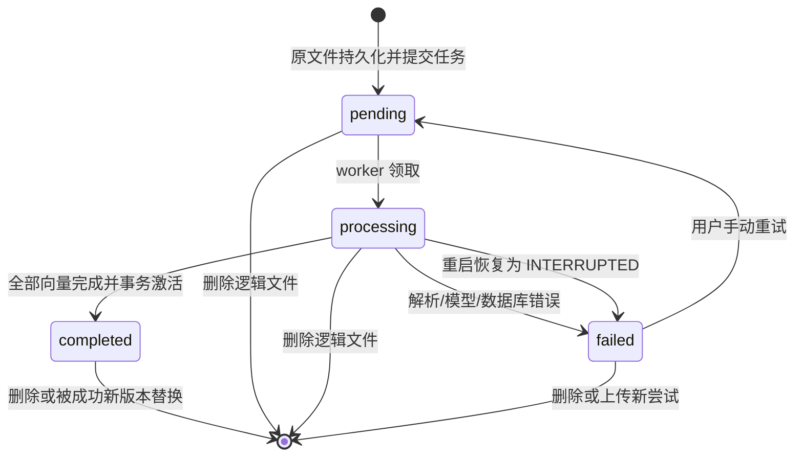

# 架构设计与维护约定

版本：0.1.0。对应 PRD V1.2。此文档描述仓库当前实现；外部服务尚未完成的效果验收单列在验证记录。

## 1. 系统边界

应用面向本机单用户。原文件、本地模型和数据库位于本机；仅生成阶段调用远程 DeepSeek。模型不能使用搜索工具，资料内指令不能获得执行权限。

开发阶段 React 由 Vite 托管并代理 `/api`；构建后 FastAPI 同源托管静态页面。Python 使用同步数据库/模型适配器，FastAPI 的同步路由在线程池执行，避免把 CPU 推理阻塞在事件循环。

## 2. 模块职责

| 模块 | 责任 | 不承担的责任 |
| --- | --- | --- |
| `main.py` | 装配依赖、HTTP 路由、错误映射、生命周期 | 不直接写版本切换 SQL |
| `config.py` | 环境配置、路径基准、参数约束 | 不联网探测密钥有效性 |
| `documents.py` | 上传校验、原文件存储、垃圾清理、原文读取 | 不解析问答或执行模型 |
| `parser.py` | 规则识别、窗口切分、token 二次切分、行号映射 | 不生成原文不存在的题目 |
| `embedding.py` | 固定 revision、本地编码、向量校验、实例复用 | 不在查询中下载模型 |
| `repository.py` | 文档版本及任务状态、向量检索、事务不变量 | 不执行远程 LLM |
| `db.py` | 连接、短事务、编号迁移、数据库就绪检查 | 不自动迁移生产数据 |
| `worker.py` | 单实例消费、分批向量化、激活、恢复 | 不把内存队列当作任务真值 |
| `llm.py` | DeepSeek HTTP、JSON 契约、总超时、有限重试 | 不自动调用工具或搜索 |
| `query.py` | 列题计划、检索、预算、引用和原题校验 | 不信任模型提供的文件路径 |
| `audit.py` | 审计 Repository、秘密脱敏、逐次调用、会话租约和留存 | 不用于当前证据召回 |
| `cli.py` | 显式迁移、模型下载和 SHA 锁定、问答查看及清理 | 不在导入模块时初始化服务 |

前端 `api.ts` 统一处理 HTTP 错误，`types.ts` 保存接口类型。知识库、问答和来源面板分别维护自身状态；不共享可变的模型输出对象。

本机启动入口为 `scripts/run_local.py`：使用现有 `data/postgres`，先检查并确保 PostgreSQL 仅监听 `127.0.0.1:5433`，必要时通过 pg_ctl 重启并刷新 pgserver 的连接缓存，迁移后启动 FastAPI。应用和 DBeaver 均可通过 TCP 访问同一数据库；应用端口已占用时入口直接退出，不先重启数据库。默认 pgserver 启动参数会禁用 TCP，因此原生模式统一使用该入口。pgserver 0.1.4 的 Unix socket URI 未携带端口，入口读取 postmaster.pid 中的实际端口作为 libpq 参数，保证已有 5433 实例可重复接入。

## 3. 数据模型

`documents.id` 是版本 ID，HTTP 状态查询与重试以它为参数。`logical_document_id` 是逻辑文件 ID，按 NFC 规范化 basename 区分文件；文件名大小写敏感。删除任意版本 ID 都删除对应逻辑文件的全部版本。

`is_active` 和 `status` 独立：替换期间，旧版本为 `completed + active`，新版本为 `pending/processing + inactive`。列表返回最新尝试，并以 `has_active_version` 表示旧版仍可检索。

数据库设置两个部分唯一索引：同一逻辑文件最多有一个 active 版本、最多有一个 pending/processing 版本。外键级联删除文本块。`query_logs` 不外键关联片段，保留删除前的诊断 ID；这些日志 ID 不能用于检索已删资料。

## 4. 文档与任务状态

任务状态在 PostgreSQL 中持久化。进程内只有一个轮询线程，没有必须恢复的内存队列。`attempt_count` 充当一次尝试的标识；迟到的旧 worker 结果不能完成或失败化新的尝试。

## 5. 事务与并发边界

| 操作 | 事务内 | 事务外 |
| --- | --- | --- |
| 上传 | 哈希去重、同名冲突、插入 pending 版本 | 原文件校验、写临时文件并 fsync/rename |
| 领取任务 | pending → processing、增加 attempt_count | 等待下一次轮询 |
| 完成入库 | 校验尝试、插入全部块、删除旧版本、激活新版本、加入文件清理队列 | 解析、模型加载和分批推理 |
| 删除 | 删除逻辑文档、级联块、文件路径加入清理队列 | 删除实际文件 |
| 问答 | 短事务检索、末尾检查来源有效性 | Query 向量化、LLM 请求和 JSON 校验 |

写操作使用 PostgreSQL 事务级 advisory lock `7654101`；它只保护短事务，不覆盖远程请求或本地模型推理。版本激活在同一事务完成，查询只能看到提交前或提交后的有效版本。

worker 另外持有会话级 advisory lock `7654102`，避免 Uvicorn 多进程或热重载产生多个消费者。只有取得该锁才恢复遗留 processing 任务。提交前再次探测该连接；任务尝试号还会防止失去锁的旧消费者覆盖新尝试。

文件系统无法参与数据库事务，`file_gc` 是清理的持久化补偿队列。数据库逻辑删除立即生效，原文件删除失败会在后续轮询再次尝试。进程若恰好在原文件落盘后、任务提交前崩溃，可能留下孤立原文件；本版不自动清理无法确认归属的原文件，定期维护时需与数据库备份核对后处理。

同名新版本成功后旧版被清理，不提供历史版本浏览。新版本失败时旧版仍有效。完全相同的内容即使换文件名上传，也返回已有版本 ID，不额外建立逻辑文档。

## 6. 解析与向量空间

解析器识别编号、Q/A、中文问答标记和带问号标题。代码围栏中的 `Q:` 不作为题目。没有稳定题目结构时保留普通文本，不强行抽题。字符窗口和 token 二次切分都会保留原文件行号；超长单行可拆成多个片段，引用仍定位到同一原文行。

EmbeddingGemma 用 `encode_document` 和 `encode_query`，启用其配套任务提示。输入 token 数包含提示和特殊 token，最大 2048；超长文档块继续切分，超长 Query 明确返回 422。

模型实例延迟加载并用锁串行访问，复用 CPU/float32 权重。运行路径强制 `local_files_only=True`。所有输出必须是 768 维、有限且非零的向量，再做 L2 归一化。

向量兼容性指纹包含模型 ID、revision、维度、dtype、归一化、编码规则及切块配置。每个有效文档保存指纹及原配置；查询或激活新文档时发现不一致即拒绝混用。MVP 采用备份后全量重新导入的重建方式。

pgvector 默认使用精确余弦检索。约千题的规模先保证正确性；后续性能数据证明需要时，再增加 HNSW 等近似索引，并重新跑召回测试。

## 7. 检索、证据及答案

普通问答 TopK 默认 8，范围 1–50。列题数量范围 1–20，候选数为 `min(50, max(top_k, 3*N))`；显式 `limit` 优先于文本中识别的数量。中文常见数字与阿拉伯数字均支持。

余弦相似度定义为 `1 - cosine_distance`，阈值只在标定集调整。SQL 先过滤低分候选。空候选不请求 DeepSeek；非空候选按实际 JSON 文本预算装配，整块保留，不截断证据。由于没有本地 DeepSeek tokenizer，预算同时采用 UTF-8 字节数作为保守上界，可能少放证据，需要在召回验收中观测这一影响。

DeepSeek 在一次结构化调用里先判断充分性再生成。服务端仍检查：

- 普通回答必须有文字和属于有效候选的引用。
- 列题必须对应引用中的真实原题，按规范化原题文本去重并限制数量。
- 只有题目没有答案的证据不能让模型补写答案。
- 返回来源字段来自数据库，不来自模型；返回前再次验证来源仍 active。

这些检查保证结构与来源边界，不能数学证明每一句话都被来源支持；人工逐条语义审核仍是质量验收的一部分。资料中的提示注入通过指令分层、无工具调用和输出校验降低影响，不能宣称已完全消除。

## 8. 错误、超时及可观察性

`AppError` 统一携带 code、message、HTTP status、retryable。数据库不可用、模型鉴权、服务超时、生成结构错误和资料不足分别表示。接口不会把数据库 DSN、API Key 或供应商原始错误返回给浏览器。

DeepSeek 使用 async HTTP client，但由同步服务入口执行；外层 `asyncio.timeout` 覆盖整次远程调用，包括退避与最多一次重试。只重试临时网络、429、5xx；鉴权/配置/结构错误不自动重试。默认总预算 30 秒。

日志按 5 MB 滚动、保留 3 个备份。查询同时持久化请求 ID、候选 ID、阶段耗时、结果、错误码和请求模型名；响应中的实际模型名在安全日志中记录。日志写入失败不覆盖查询原始结果。

`/api/health` 检查数据库迁移及连接，报告模型锁文件是否存在；它不是完整的模型加载或远程服务就绪保证，避免健康探测反复消耗内存和付费请求。

## 9. 演进与文档维护

- 先维持直线式 RAG，不引入复杂 Agent 编排。
- 扩展 PDF/DOCX 时新增解析适配器和页码来源模型，不复用 MD 行号冒充页码。
- 引入消息队列前保留数据库状态为任务真值，保证幂等、尝试号和删除失效语义。
- 每次修改任务状态、事务边界或异常策略，同步修改本文件与时序图，并补充真实数据库回归。
- 新增模块按依赖方向放置；不让低层适配器导入 HTTP 路由或 UI 概念。

外部接口参考：[DeepSeek API](https://api-docs.deepseek.com/)、[EmbeddingGemma](https://huggingface.co/google/embeddinggemma-300m)、[pgvector](https://github.com/pgvector/pgvector)。依赖解析结果以 `backend/uv.lock` 与 `frontend/package-lock.json` 为准。

## 问答审计与留存（FR-07）

`audit.py` 是独立的审计 Repository，SQL 不进入路由。`QueryService` 建立 `QueryTrace`，保存原始问题与选项，再执行检索/预算；`DeepSeek` 每次 HTTP 前保存 pending 调用，收到响应先保存原文，再解析输出；用例完成引用及来源校验后才保存最终响应并返回。HTTP 200 后仍可能因 JSON、引用或来源校验变为 error，原始响应保留。测试替身没有实际远程调用时不伪造 llm_calls。

迁移 `002_query_audit.sql` 新增两张表；就绪检查要求该迁移存在。JSONB 保存结构化输入、参数、快照和最终结果，TEXT 保存可能不是 JSON 的原始响应。一个请求可有两次调用，每个 `(request_id, attempt_no)` 唯一。证据不引用现存 chunks/documents 外键，删除知识文件后快照仍可查看。`document_ids text[]` 的 GIN 索引用于按旧版本清理整条问答；query_records 删除级联到 llm_calls，query_logs 不级联。

每个活跃问答使用独立 autocommit 连接持有 PostgreSQL 会话 advisory lock，lease_key 由请求 ID 生成。其他 SQL 均为短事务，模型调用不占用事务或文档写锁。恢复任务对 running 行使用 `FOR UPDATE SKIP LOCKED`，并尝试获取对应事务 advisory lock；取不到说明仍活跃，跳过。连接断开后租约释放，下一次维护把失去租约的 running/pending 标记为 interrupted。不会自动重发远程请求。每次调用前检查租约连接；终态更新要求问答仍为 running，避免迟到结果覆盖已恢复的状态。

审计事务失败统一转为 `AUDIT_UNAVAILABLE`。发送前登记失败则禁止 HTTP；响应或最终结果写入失败则返回 503，不声称保存成功。尽可能记录固定错误及步骤，记录错误本身也失败时只在普通日志记请求 ID 与安全错误标记，留存的 running 行可由恢复处理。极端的“供应商已收到请求但本地进程随即退出”只能记为结果未知；model_called 指尝试已登记，不能证明供应商一定执行。

所有持久化业务字段集中经过 `SecretRedactor`，处理已配置密钥、HF Token、数据库密码、敏感 JSON 字段、Bearer 和凭据 URL；正常内容不做摘要或截断。无秘密的 raw_response 保留原样；含秘密时脱敏后格式可能变化。鉴权头从不作为保存对象。普通文件日志没有完整问题、证据和模型输出。

留存默认从创建起 30 天，字段 `expires_at` 在创建时确定。worker 获取主租约后先恢复/清理，并按默认 3600 秒维护；长入库任务会延后下一次维护。禁用 worker 时使用本地 `recover-records`、`purge-records` 命令。自动清理只删到期终态；手动可按请求、历史文档版本、含时区的开始时间范围清理，全部跳过 running。范围使用 `[after, before)`，dry-run 统计符合条件的问答数。删除整条问答确保问题、答案、请求 messages 内重复的原文也一并删除。备份和导出内容不随在线清理改变。

范围仅限已通过 HTTP 请求格式校验的单轮问答，格式校验失败不保存原始非法请求体。此次升级不补录历史、不增加历史 HTTP 接口或历史页面，不自动回传旧对话。
