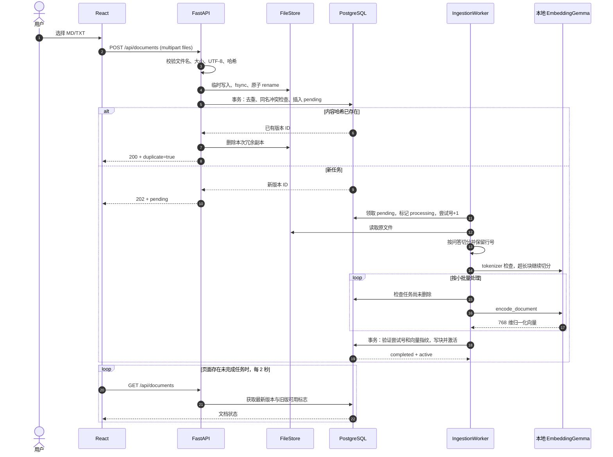
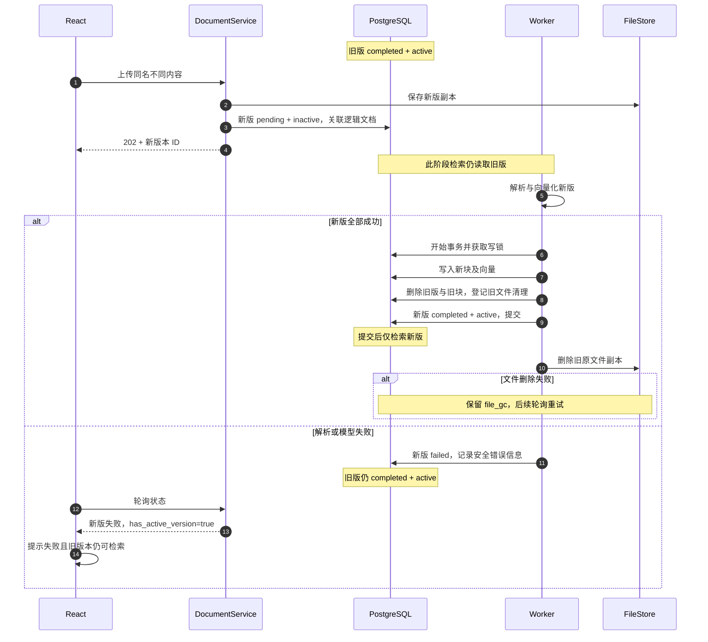
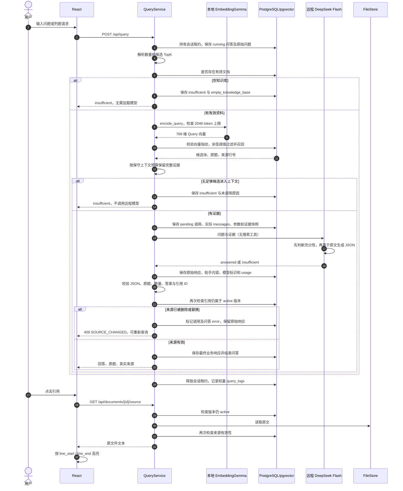
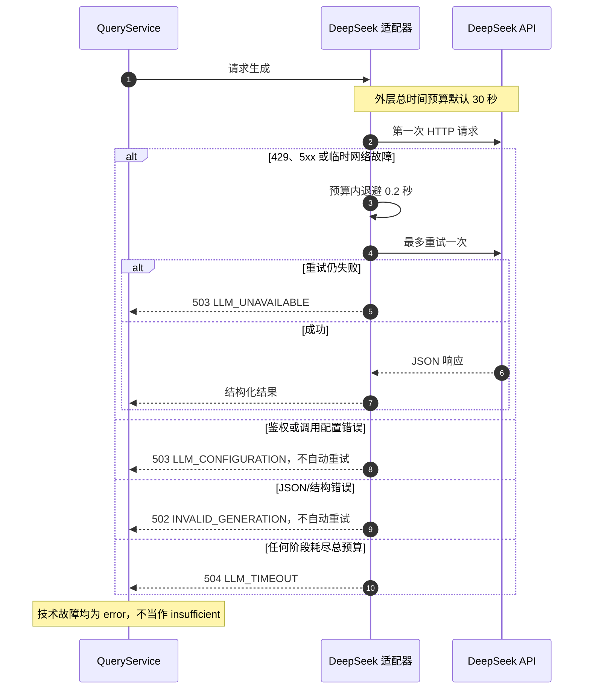
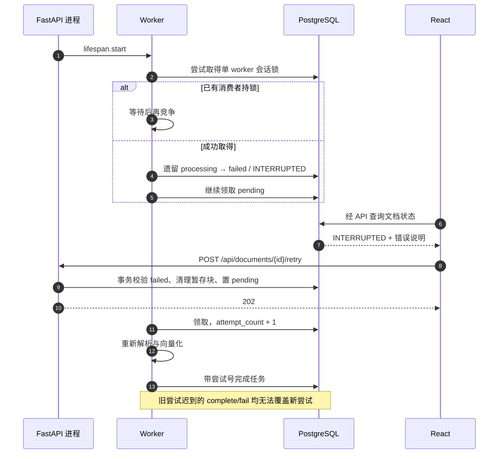
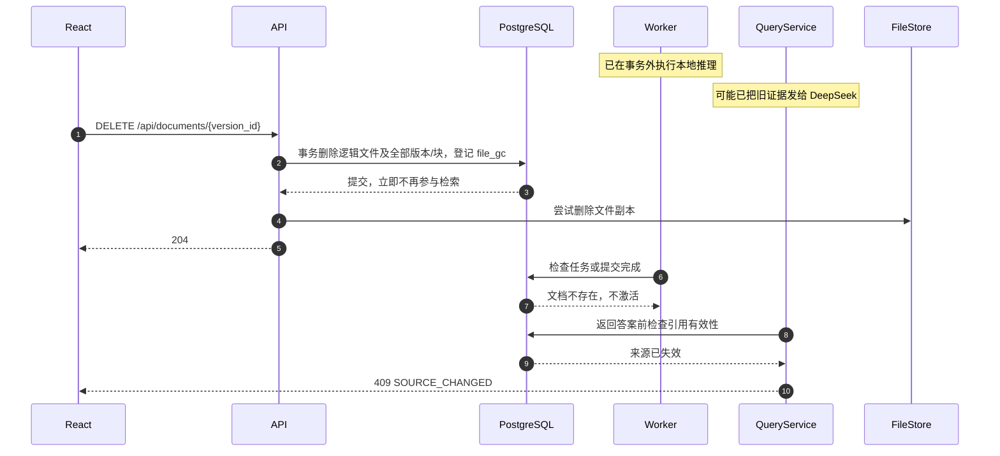
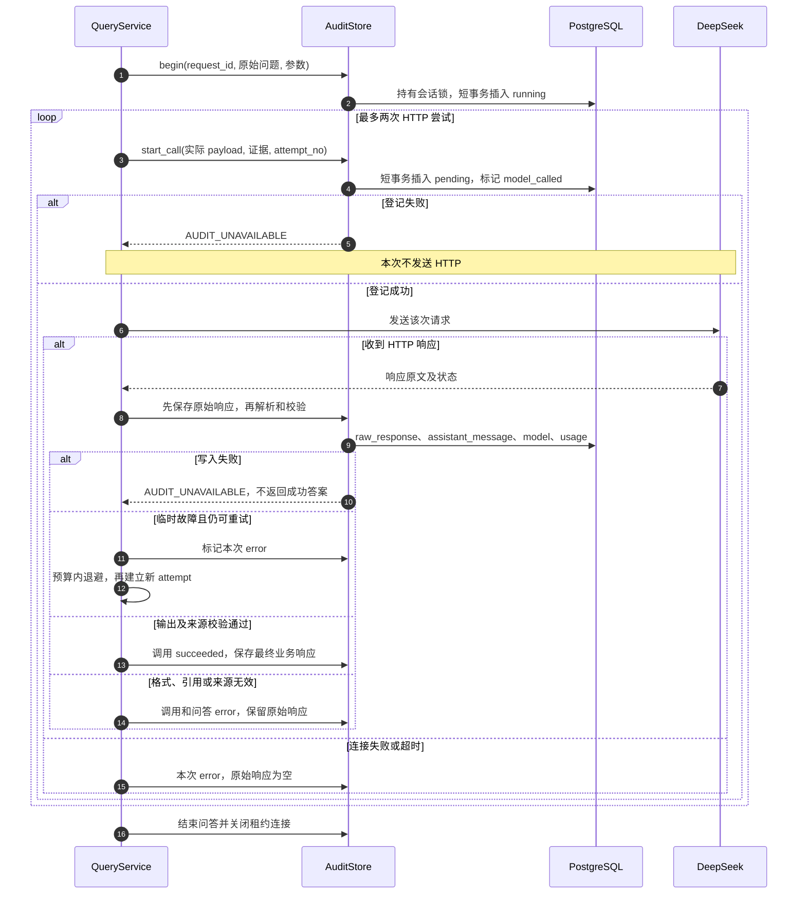
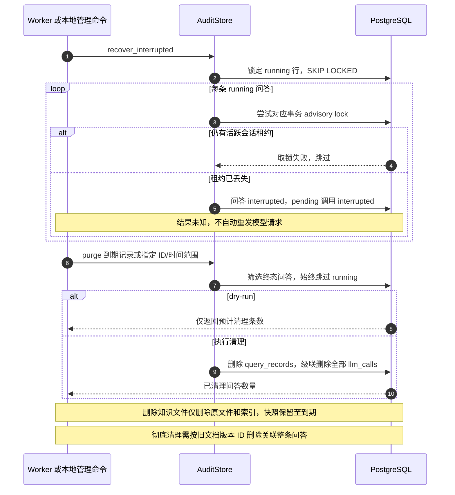

# 核心流程时序图

对应当前后端模块与 PRD V1.2。图中 DB 事务均为短事务；本地推理与远程请求不占用版本切换锁。

## 1. 上传与后台入库

多文件上传逐文件处理，允许部分成功；整个批次返回 207，每项有独立 status_code。

## 2. 同名替换与失败保留旧版

## 3. 查询、证据判断与原文定位

日志在服务 `finally` 中写入，先于 HTTP 实际发送；图中放在流程末尾表示所有结果分支都会执行。

## 4. 远程故障与总超时

## 5. 重启、恢复与手动重试

本机模式在以下 FastAPI 生命周期之前，由 `scripts/run_local.py` 确保 PostgreSQL 的 loopback TCP 监听和迁移就绪；必要的数据库重启在启动 worker 之前完成。

## 6. 删除正在处理或生成中的文档

已经发送给 DeepSeek 的证据无法因后续删除而撤回；页面和 README 的远程数据流告知覆盖这一边界。已返回浏览器的历史文本也不会被数据库删除自动擦除；发起新查询或重新展开来源时会重新校验。

## 8. 逐次调用审计及写入失败

两个错误层次独立：远程调用成功而最终业务响应保存失败时，调用可为 succeeded、问答为 error。无法记录错误本身时仍返回 503，普通日志只记录请求 ID 和安全标记。

## 9. 中断恢复、留存及文档清理

