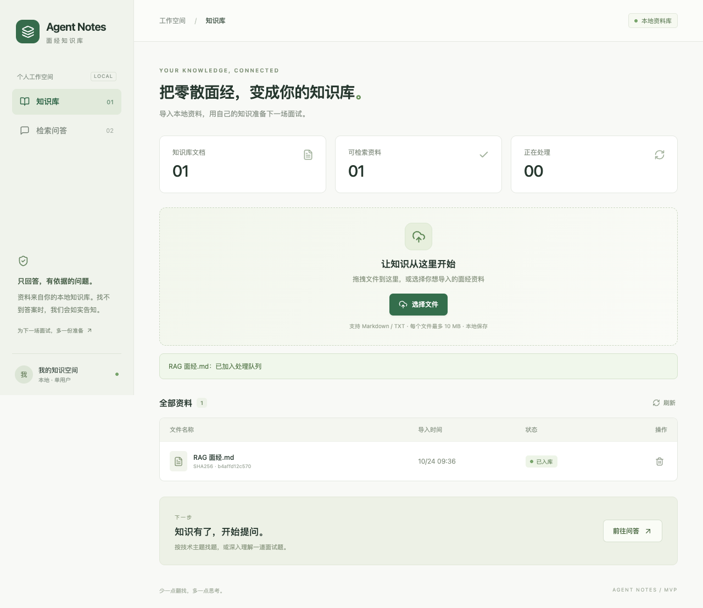
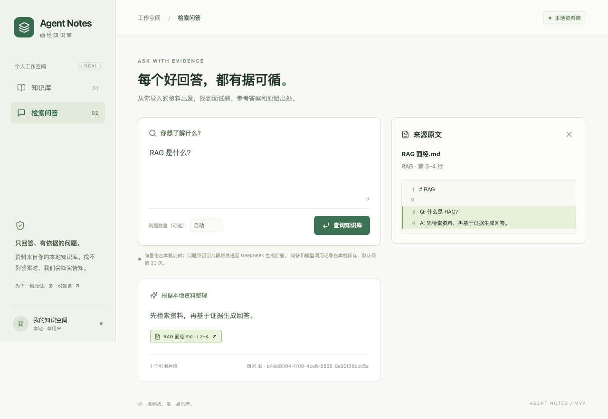
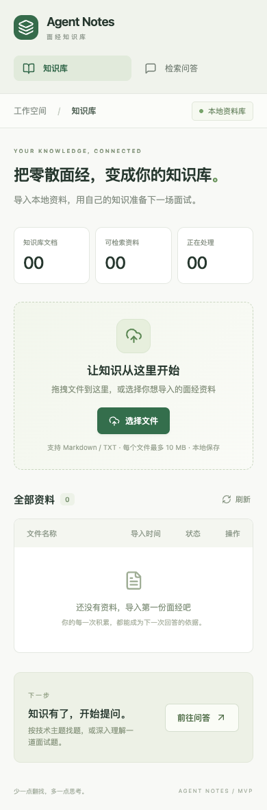

# 开发验证记录

日期：2026-10-23，2026-10-24 补充 FR-07（Asia/Shanghai）。本记录只陈述已实际执行的结果，不等同于 PRD 的最终效果验收。

## 已执行验证

| 检查 | 结果 | 实际范围 |
| --- | --- | --- |
| Python 回归测试 | 39 passed | 规则、模型边界、模型下载/离线约束、远程 HTTP 适配器、真实数据库及 API |
| PostgreSQL + pgvector | 通过 | 临时 PostgreSQL 16.2，隔离 schema，执行实际 SQL 与向量距离查询 |
| Chrome 端到端 | 4 passed | 上传、后台处理、问答、原文高亮、删除、重复文件、无答案、错误区分、移动端 |
| React 生产构建 | 通过 | TypeScript 检查及 Vite 构建 |
| Ruff | 通过 | 后端、脚本、根目录入口的静态检查及格式检查 |
| 固定样本哈希 | 通过 | 3 份 MD、35 条查询及 manifest 一致 |
| 文档图及链接 | 通过 | 7 份 Markdown，11 个 Mermaid 图，仓库相对链接有效 |
| 推理依赖导入 | 通过 | sentence-transformers 5.7.0、torch 2.14.1 |

测试版本以依赖锁文件为准。集成测试确实使用 PostgreSQL 和 pgvector，并非以 SQLite 模拟；Embedding 与生成模型使用可控替身，HTTP 适配器使用 MockTransport。

浏览器测试的数据库独立创建、退出后清理，只监听 127.0.0.1，不读取用户真实面经或消耗 DeepSeek 额度。

## 关键回归覆盖

- 同名替换失败后旧版仍可查询，重试成功后旧块失效。
- 无效向量导致激活事务回滚，不写入部分有效块。
- 并发同名上传只允许一个任务；相同哈希不重复写入。
- 删除处理中任务后，迟到结果不能重新激活文档。
- 重启恢复 processing，重试次数递增，旧尝试的 complete/fail 不覆盖新尝试。
- 相似度过滤与向量空间指纹检查。
- 服务端拒绝不存在的引用、无引用回答、编造原题或为无答案记录补写。
- 回答期间来源删除返回 SOURCE_CHANGED，不展示失效引用。
- 远程临时错误最多重试一次，鉴权错误不重试，总预算超时返回独立错误。
- 文件格式、UTF-8 编码、空文件、大小上限、批量部分成功。

## 真实环境补充验证（2026-10-23）

- 用户完成 Hugging Face 许可确认及本机只读令牌登录，DeepSeek Key 已在本机配置，未记录任何凭据内容。
- EmbeddingGemma 权重下载完成并通过 SHA256 校验，锁定 revision：`57c266a740f537b4dc058e1b0cda161fd15afa75`。
- 在 `HF_HUB_OFFLINE=1` 下进行真实本地推理：输出 768 维向量，中文 RAG 查询正确匹配对应资料；三条合成候选的相似度为 0.7740、0.1437、0.1240。
- 独立探测首次模型加载与样例编码共 5.69 秒，CPU 线程数设为 2；这是单次初始化记录，不代表 P95。
- 真实 DeepSeek API 调用返回 answered，引用 ID 检查通过。
- 已正常重启真实应用并加载最新配置，健康接口返回 `status=ok`、`model_cached=true`。
- 在空知识库中上传一份临时合成资料，实际验证完整链路：上传 → EmbeddingGemma → PostgreSQL/pgvector → DeepSeek → 来源原文。临时文档及其索引已清理，未保留演示知识。

## 尚未完成的外部验证

1. DeepSeek 已完成真实基础联调，端到端 P95 仍未测量。
2. EmbeddingGemma 已完成真实离线编码和单样例链路验证，固定中文验收集的整体召回率仍未测量。
3. **本机未安装 Docker 命令**，因此 Compose 的 PostgreSQL 17 镜像未实际启动；相同迁移与查询已在临时 PostgreSQL 16.2 上运行验证。
4. `SIMILARITY_THRESHOLD=0.5` 只是默认调试值，尚未用 calibration 标定；独立验收集 Recall@8 ≥90%、正确拒答及逐条语义支撑仍待真实模型验收。
5. 大约 1000 道题规模的性能目标和完整生产式重启演练未完成，不能据单元测试推断已经达标。

测试输出含一条上游 Starlette TestClient 对 httpx 的弃用提示，当前测试通过；这是测试客户端兼容提示，不是业务故障。

## 界面检查

以下截图来自真实浏览器测试页面，其中答案使用确定性假模型：







## 复现命令

```bash
LC_ALL=C RUN_POSTGRES_TESTS=1 backend/.venv/bin/pytest backend/tests -q
backend/.venv/bin/ruff check --config backend/pyproject.toml backend scripts main.py
backend/.venv/bin/ruff format --config backend/pyproject.toml --check backend scripts main.py
backend/.venv/bin/python scripts/evaluate.py verify-fixtures
npm --prefix frontend run build
npm --prefix frontend run test:e2e
npm --prefix frontend run docs:check
```

真实模型配置完成后，按 acceptance.md 运行标定与独立验收，并将结果补充在此记录中，保留模型 revision、阈值、样本版本和性能条件。

## 本机 TCP 与 DBeaver 接入验证（2026-10-23）

- 新增 `scripts/run_local.py`，确保原生 PostgreSQL 使用 `127.0.0.1:5433`；重复启动时配置一致则不重启数据库。
- 使用 psycopg 实际通过 TCP 连接，确认数据库和用户均为 postgres；现有本机开发认证下密码留空。
- lsof 确认只在 `127.0.0.1:5433` 监听，没有绑定全部网络接口。
- 调整前后文档数均为 1、文本块数均为 139；query_logs 可正常读取。
- 项目健康接口 HTTP 200 / ok。本机 `.env` 数据库连接已同步更新。
- DBeaver 的连接参数已记录在 README；验证使用相同 TCP 参数，尚未代替用户操作 DBeaver 图形界面。
- 新增两项启动参数回归，完整后端测试结果为 41 passed；Ruff 静态与格式检查、更新文档的本地链接检查均通过。

## FR-07 问答与逐次模型调用留存（2026-10-24）

- 新增迁移 `002_query_audit.sql`、独立 `AuditStore` / `QueryTrace`、DeepSeek 逐次记录与本地 records / purge-records / recover-records 管理命令。
- 完整后端回归 **63 passed**：包含真实临时 PostgreSQL/pgvector、API 与 21 项审计测试；相比此前新增审计和原生非默认 socket 端口回归。初始审计测试先确认缺少 app.audit 而失败，再实现通过；端口回归先确认缺少 port 参数而失败，再修复通过。
- **Chrome 4 passed**，使用独立临时库、确定性模型，覆盖上传/入库/问答/原文/删除及异常；新前端增加本机留存提示。TypeScript/Vite 构建、Prettier、Ruff 静态与格式检查均通过。
- 固定验收资料哈希校验通过：3 份资料、35 条查询。文档本地链接及 **13 个 Mermaid 图**校验通过。
- 故障注入验证：query_start / call_start 写入失败不发 HTTP；response_save / query_finish 失败返回 503，不伪装保存成功；非法响应仍留存原文，数据库检索故障保持 DATABASE_UNAVAILABLE / 503，轻量错误响应不泄露原始 SQL。
- 记录验证：实际 messages / 参数一致，原始 HTTP 响应、助手消息、模型标识、usage、证据及最终响应可重建；503 重试两行，超时没有伪造响应，无效引用标记 output_validation。
- 边界验证：空库、阈值无候选、预算不足没有虚构调用；凭据脱敏且业务内容不进入文件日志；删除知识文件后快照仍在，按旧文档版本清理整条问答并级联调用；dry-run、时间半开范围、到期清理跳过 running；活跃会话租约不误恢复，失租约后恢复为 interrupted。
- 本机已有数据库通过标准入口迁移至 002，表在 `127.0.0.1:5433 / postgres / public`。迁移前后用户原有资料均为 **1 份文档、139 个片段**。
- 使用临时合成面经通过**真实 EmbeddingGemma → pgvector → DeepSeek**，实际问答为 answered、调用 1 次、usage 保存成功；校验 final_response 与 HTTP 结果一致，快照包含本次文档，删除文档后快照仍存在，再定向清理该次问答。临时文档、片段、完整问答及调用均已清理，未删除用户原有资料。
- 本机标准入口已重新启动，页面及健康检查可用。重启发现 pgserver 0.1.4 的 socket URI 未携带非默认端口，现显式使用 postmaster.pid 中端口，避免再次启动误连 5432。

本次实际联调证明留存链路和本机服务可用，不替代独立验收集的中文语义效果和性能验收。上线前的历史问答无法补录；仅从本次版本开始保存。完整记录清理不清除 query_logs 轻量摘要、离线备份或用户导出文件。
